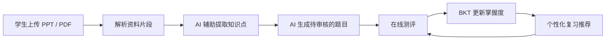
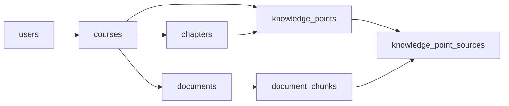
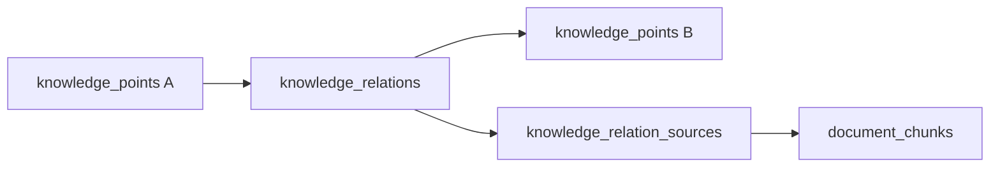
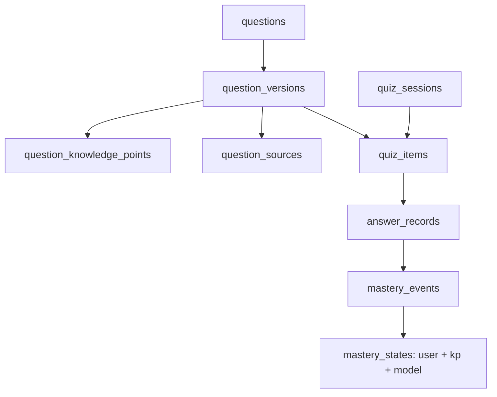

# 知迹 KnowTrace — 数据模型与数据库设计说明书

> **文档版本**：v1.0（设计稿，2026-10-28）  
> **项目定位**：第 20 题《智能教育评测与个性化学习系统》  
> **代码仓库**：<https://github.com/Junpgle/KnowTrace>  
> **推荐存放路径**：`docs/data-model.md`  
> **配套 SQL**：`database/schema.sql`  
> **状态**：尚未部署；本文约定数据契约、表结构与实现边界，不代表功能已经完成。

## 0. 设计结论（先看这部分就够了）

KnowTrace 的核心闭环如下：



**不能从一开始设计错的四件事**：

1. **资料有来源**：知识点、知识关系、题目都能追溯至哪个文件、哪一页或幻灯片。
2. **题目有版本**：已用于答题的题干和正确答案不可被静默覆盖。
3. **作答有事件**：保存每次答题的顺序与原始记录，不能只存平均正确率。
4. **关系有类型**：“包含”“相关”“使用”“先修于”是不同的关系；AI 推断先修关系须审核。

数据库在设计层面一次规划 19 张表，并非要求第一周把 19 个模块全部开发完。最早的可运行功能只需用到其中一部分；其余表保持空表即可。

## 1. 版本与范围

### 1.1 与旧 SRS 的差异

旧 `KnowTrace_SRS_v1.0.md` 原先允许第一版由学生手工维护题库。**此后需求已经确定改变**：用户通常只有 PPT、电子教材和学习资料，没有现成题库。因此新版产品把 **资料解析、知识点提取、AI 题目生成与题目审核** 提升为主要流程。

建议随后将需求文档修订为 **SRS v1.1**。本数据模型按最新讨论设计，不默认旧 SRS 中有关“AI 出题是 P1”的描述继续有效。

### 1.2 第一版边界

- 本地单用户使用，但保留 `user_id`，避免以后多用户时重构。
- 数据库天然支持多课程；先用《计算机网络》的 9 份真实课件作为验证样例。
- 第一版优先支持可提取文本的 PDF 和 PPTX。扫描版 PDF、复杂图表的视觉理解属于增强能力。
- 先支持**单选题、判断题**的稳定自动判分。多选、简答、主观题自动批改延后。
- 知识图谱先用关系表实现，不必立即引入 Neo4j。
- BKT 仅根据一道题所指定的**主要知识点**更新状态；其他知识点是辅助标签。
- AI 生成的知识点、先修关系、题目需经过规则检验或人工确认；不保证所有自动生成内容正确。

## 2. 统一数据规范

| 项目 | 规范 | 原因 |
|---|---|---|
| 主键 | `TEXT`，由应用层生成 UUIDv7 / UUID4 / ULID 中**选定的一种** | 不用名称作为外键；便于将来换数据库 |
| 时间 | UTC ISO 8601，例如 `2026-10-28T10:00:00.000Z` | 不依赖服务器时区；前端显示当地时间 |
| 命名 | 数据库 `snake_case`；API 对象同样 `snake_case` | 保持 ORM、API 一致 |
| 删除 | 课程、文档、知识点、题目原则上**归档而非硬删除** | 历史报告和教材来源不能断链 |
| AI 状态 | `pending / approved / rejected` 等显式状态 | “生成完成”不等于“内容正确” |
| JSON | 题目选项、学生回答、模型参数等低频变结构字段用 JSON 字符串 | 题型可扩展，同时固定核心关系仍用外键 |
| 文件 | 原始 PDF/PPTX 存文件系统或对象存储；数据库保存 `storage_key` 与 SHA-256 | 不把大文件直接塞入 SQLite |
| 数据库 | SQLite + SQLAlchemy + Alembic | 本地起步轻量，保留迁移能力 |

> **注意**：SQLite 的外键必须在**每个连接**执行 `PRAGMA foreign_keys=ON`。跨课程一致性、图谱环检测、题目发布审核等复杂业务约束应由应用服务层校验（或后续增加触发器）。

## 3. 业务实体及关系

### 3.1 学习资料与课程组织



- **课程 / 章节**用于还原老师的原始教学目录。
- **知识点**可以属于某章，也可在多个章节中反复出现；其资料出处通过 `knowledge_point_sources` 实现多对多关联。
- 第 2 章的“数据通信 A/B”是两份资料，不必建成两门课程。
- 资料修改后，不覆盖旧文件内容：上传新 `documents` 行，并通过 `supersedes_document_id` 链接旧版本。

### 3.2 知识关系



关系采用方向 `source_kp_id -> target_kp_id`。

| `relation_type` | 含义 | A -> B 的例子 | 是不是先修？ |
|---|---|---|---|
| `prerequisite_required` | A 是学习 B 的必要基础 | IP 地址 -> 子网掩码（需结合实际教学粒度审核） | 是 |
| `prerequisite_recommended` | 建议先学 A，再学 B | 基础网络分层 -> DNS 深入机制 | 推荐，不是硬性 |
| `contains` | A 包含子知识 B | 数据链路层 -> 封装成帧 | 否 |
| `related` | A 与 B 有联系 | 快速排序 <-> 归并排序 | 否 |
| `uses` | A 使用 B | DNS -> UDP（按课件给出的典型情形） | 否 |
| `compares` | A 与 B 常做对比 | TCP <-> UDP | 否 |

**特别规则**：
- `contains / prerequisite_* / uses` 是定向关系；`related / compares` 在业务语义上是无向关系，落库时用稳定 ID 顺序规范化，避免 A-B 与 B-A 重复。
- 仅对**已审核**的 `prerequisite_required` 关系做有向无环（DAG）检查；失败时拒绝发布。建议先修的环应提示审核，而非直接套入硬性限制。
- 判断依据与文件页码要能从 `knowledge_relation_sources` 回溯；AI 的主观评分不能伪装成真实准确率。

### 3.3 题库、测评与知识追踪



- `questions` 是**题目的逻辑身份**，`question_versions` 是**不可随意变更的具体版本**。
- `question_knowledge_points` 允许一题多个知识点，但一版本**最多一个主要知识点**。
- `quiz_items` 固定一场测试所用的题目版本与主要知识点，因此以后题库更新不会改写历史考试结果。
- `answer_records` 保存答题事件；`mastery_events` 保存算法计算前后概率；`mastery_states` 只保存便于快速查询的当前状态。

## 4. 数据字典（19 张表）

> 标记：**P0** = 首次完整闭环必须实际用到；**P1** = 数据结构先设计好，功能可后做。配套 SQL 已列出具体类型、主外键和索引。

| 表名 | 重要字段 | 含义 | 开发阶段 |
|---|---|---|---|
| `users` | `id`, `username` | 用户身份（首版可默认账户） | P0 |
| `courses` | `id`, `owner_user_id`, `title`, `status` | 学科 / 课程 | P0 |
| `chapters` | `id`, `course_id`, `parent_chapter_id`, `ordinal` | 支持多级目录 | P0 |
| `documents` | `id`, `course_id`, `storage_key`, `sha256`, `supersedes_document_id` | 上传的原始课件 | P0 |
| `document_chunks` | `id`, `document_id`, `page_start`, `page_end`, `content_text` | 资料分段与定位 | P0 |
| `processing_jobs` | `id`, `job_type`, `engine_name`, `prompt_version`, `status` | AI 任务及复现信息 | P0 |
| `knowledge_points` | `id`, `course_id`, `canonical_name`, `review_status` | 知识点主数据 | P0 |
| `knowledge_point_sources` | `knowledge_point_id`, `chunk_id` | 知识点来自哪里 | P0 |
| `knowledge_relations` | `source_kp_id`, `target_kp_id`, `relation_type`, `review_status` | 语义及学习关系 | P1 |
| `knowledge_relation_sources` | `relation_id`, `chunk_id` | 关系的证据来源 | P1 |
| `questions` | `id`, `course_id`, `origin`, `archived_at` | 逻辑题目 | P0 |
| `question_versions` | `question_id`, `version_no`, `stem`, `options_json`, `correct_answer_json`, `review_status` | 具体题干、答案及版本 | P0 |
| `question_knowledge_points` | `question_version_id`, `knowledge_point_id`, `is_primary` | 一题关联多个知识点 | P0 |
| `question_sources` | `question_version_id`, `chunk_id` | 出题来源 | P0 |
| `quiz_sessions` | `id`, `user_id`, `course_id`, `mode`, `status` | 一次测评 | P0 |
| `quiz_items` | `session_id`, `question_version_id`, `position`, `primary_knowledge_point_id` | 测评具体题目及顺序 | P0 |
| `answer_records` | `quiz_item_id`, `client_request_id`, `response_json`, `is_correct`, `answered_at` | 单题作答 | P0 |
| `mastery_states` | `user_id`, `knowledge_point_id`, `model_key`, `p_mastery`, `observations` | 当前知识掌握估计 | P0 |
| `mastery_events` | `answer_record_id`, `p_before`, `p_posterior`, `p_after`, `parameters_json` | 掌握度变化历史 | P0 |

### 4.1 业务约束（SQL 之外必须校验）

1. `chapters.course_id` 必须与其父章节课程一致；不允许章节树循环。
2. `knowledge_points.chapter_id` 必须属于相同课程；资料片段与知识点必须属于同课程（或明确授权的跨学科引用）。
3. 知识关系的两个端点首版必须同课程；跨课程关系以后单独开放并增加权限校验。
4. 每个**已批准、可用于自动测评**的题目版本必须恰有一个主要知识点，且属于同一课程。
5. AI 自动生成的题目必须具备至少一个教材证据片段，未通过检查时保持 `pending` 或 `rejected`。
6. 只有 `approved` 的题目版本才能加入正式测评；题目批准后不允许原地改动，修改必须生成 `version_no + 1`。
7. 同一 `quiz_item` 只能有一条作答；同一请求 `client_request_id` 重试必须返回历史处理结果，不重复计算 BKT。
8. 已完成测评不能再提交答案；不能把 `correct_answer_json` 暴露给正在答题的客户端。
9. 仅主要知识点更新 BKT；辅助关联知识点不因为一题答错就自动减分。
10. 资料归档后保留出处、题目版本和历史记录；硬删除需要单独的数据清理策略。

## 5. 关键状态与数据生命周期

### 5.1 教材导入 / AI 生成

```text
上传文件（documents.uploaded）
  -> 解析 PDF/PPTX（processing_jobs: document_parse）
  -> 文档片段与页码（document_chunks）
  -> 提取知识点候选（knowledge_points.pending + knowledge_point_sources）
  -> 审核/归一化知识点（approved）
  -> 为知识点检索相关片段，生成题目草稿（question_versions.draft）
  -> 校验单选题唯一正确答案、解析、资料出处和知识点对应关系
  -> 待审核（pending）
  -> 审核通过（approved）
  -> 可参与测评
```

这里“AI 已运行成功”与“题目审核通过”是两个不同事件。AI 生成的内容**不得直接默认为正确题库**。未来可以加入自动校验，但必须允许学生查看或纠正。

### 5.2 测评与 BKT 更新：一个原子事务

```text
查询当前会话状态
  -> 根据 approved 题目生成 quiz_items（固定具体版本）
  -> 用户提交作答（带 client_request_id）
  -> 检查是否已提交（幂等）
  -> 服务端比对标准答案并记录 answer_records
  -> 获取主要知识点的 mastery_states
  -> BKT 计算并写 mastery_events
  -> 更新 mastery_states
  -> 返回结果（不得发生“作答写入成功但掌握度漏更新”）
```

**事务要求**：`answer_records`、`mastery_events` 和 `mastery_states` 必须在同一事务中提交；SQLite 在本地可以使用 `BEGIN IMMEDIATE` 避免同时更新同一掌握状态造成丢失更新。若客户端重试，使用唯一 `client_request_id` 做幂等处理。

### 5.3 为什么要保留 `mastery_events`？

因为掌握度 0.72 是当前**模型输出**，不是客观成绩。以后修改 BKT 参数或换成 DKT 时，可以根据 `answer_records` 重放历史数据，生成新的模型状态，同时保留旧模型的计算历史。

## 6. BKT 需要的输入与输出

设 `p` 为答题前掌握概率、`S` 为 slip（会但答错）、`G` 为 guess（不会但猜对）、`T` 为学习转移概率：

```text
如果答对：posterior = p*(1-S) / [p*(1-S) + (1-p)*G]
如果答错：posterior = p*S / [p*S + (1-p)*(1-G)]
更新后：next = posterior + (1-posterior)*T
```

- 每个课程知识点应可配置或继承 `P(L0) / T / G / S`。**第一版参数可放受版本管理的配置文件**；每次计算把生效参数写入 `mastery_events.parameters_json`。
- `mastery_states.p_mastery` 为**下一次答题之前的先验掌握概率**；尚无答题数据时显示“待评估”，不把默认值包装成实际掌握成绩。
- 作答按 `answered_at` 和固定事件顺序处理；时间相同的情况用序列/ID 决定顺序，不能靠数据库随机顺序。
- 若用一份教材自动生成的题目训练/评估算法，应先清理明显重复题，否则会高估用户能力与系统指标。

## 7. AI 与来源可追溯设计

### 7.1 资料页码是第一等数据

`documents` 保存文件身份，`document_chunks` 保存原文、页码或 PPT 幻灯片位置。生成知识点、关系、题目时，均通过关联表指向 `document_chunks`，界面才能显示：

> “这道题来自《第七章传输层.pdf》的第 N 页（实际入库后按真实页码显示），对应知识点：TCP。”

**不要**让模型在输出里自由编造页码。先由解析程序给每个片段写入真实 `page_start/page_end`，模型只允许引用已经存在的 `chunk_id`。

### 7.2 `processing_jobs` 的作用

记录哪个处理任务、何种模型/算法版本、Prompt 版本、输入指纹、完成状态。AI 生成的实体和题目通过 `created_job_id` 指回处理任务；这样可以复现、比较不同策略的质量。

### 7.3 何时需要视觉模型？

PPT 的网络拓扑图、协议流程图可能几乎没有可提取的段落文字。第一版可以只处理文本并提示“某些图形未解析”；后续将图像描述以 `document_chunks.content_kind='figure_description'` 入库，不必修改核心知识与题库表结构。

## 8. 建议 API 的核心对象（简例）

下面是**设计示例数据，不是从课件实际抽出的完整结果**：

```json
{
  "knowledge_point": {
    "id": "kp_001",
    "course_id": "course_network",
    "canonical_name": "TCP 三次握手",
    "review_status": "approved",
    "source_chunk_ids": ["chunk_transport_15"]
  },
  "question": {
    "id": "q_001",
    "version_id": "qv_001",
    "version_no": 1,
    "primary_knowledge_point_id": "kp_001",
    "question_type": "single_choice",
    "review_status": "approved",
    "source_chunk_ids": ["chunk_transport_15"]
  }
}
```

客户端答题阶段返回**不含答案**的题干与选项；结果页面在提交成功后才返回标准答案与解析。

## 9. 开发阶段拆分（不推翻数据结构）

| 里程碑 | 真正实现的功能 | 主要涉及表 |
|---|---|---|
| M1 | 工程、课程、章节、资料上传与解析 | `users`, `courses`, `chapters`, `documents`, `document_chunks`, `processing_jobs` |
| M2 | AI 提取知识点、生成题目、来源引用、审核流程 | `knowledge_points`, `knowledge_point_sources`, `questions`, `question_versions`, `question_knowledge_points`, `question_sources` |
| M3 | 测试、自动判分、BKT、学习分析 | `quiz_sessions`, `quiz_items`, `answer_records`, `mastery_states`, `mastery_events` |
| M4 | 先修关系、知识图谱、个性化复习推荐 | `knowledge_relations`, `knowledge_relation_sources`，复用 M3 的历史数据 |

复习推荐第一版可以根据 `mastery_states` 和知识关系动态计算，不必过早建立独立 `recommendations` 表；以后若需要推送任务、安排复习日期、保存用户接受/拒绝推荐的行为，再新增 `study_plan_items` 和 `recommendation_events`。

## 10. 验收测试（数据库层）

以下测试通过，才算数据基础合格：

- [ ] 上传《第七章传输层.pdf》后，文档元数据与原文件 SHA-256 已保存。
- [ ] 解析出教材片段且页码为真实页码；同一文件 `chunk_index` 不重复。
- [ ] 同一个知识点可以引用多个教材片段，不因多次出现而复制出很多同名节点。
- [ ] AI 生成的题目是草稿/待审核状态；未批准题目无法进入正式测评。
- [ ] 一道题关联多个知识点时只有一个 `is_primary=1`，只有主知识点更新 BKT。
- [ ] 原题修改后产生新版本，老测评仍指向原版本，历史判分不变化。
- [ ] 重复提交同一 `client_request_id` 不产生第二条作答和第二次 BKT 更新。
- [ ] 写入作答与更新掌握度失败时整体回滚，无半成品状态。
- [ ] 资料归档后仍可以查到历史题目引用的页码和证据。
- [ ] 把“DNS 使用 UDP”与“DNS 必须先学 UDP”区分为不同关系，不自动等同。
- [ ] 已批准必要先修关系中不存在自环或环路；可疑关系可以保留 `pending`。
- [ ] 第二门课程可以复用全部表结构，不需要新建一套课程专属表。

## 11. 已知限制与后续演化

1. SQLite 版的 SQL 已验证语法，但**不能替代后端服务层的全部业务校验**；跨课程关联、发布条件、先修环检测均需实现。
2. 数据库有 JSON 字符串字段，后端需要用 Pydantic 等验证 `options_json / response_json` 的具体格式。
3. 尚未设计课程共享、团队权限、文件脱敏及云端高并发；首版按本地单用户配置。
4. 更复杂的统计报表可以从 `answer_records` 和 `mastery_events` 派生，暂不提前存大量冗余汇总值。
5. 教育领域的“掌握度”是模型估计值，需要离线校验与实际使用中的反馈，不应宣称为精确的真实能力。

---

**当前交付物**：本设计文档 + 可执行的 SQLite 建表脚本 `KnowTrace_schema_v1.sql`。目前尚未提交到 GitHub；建议提交路径：

```text
KnowTrace/
├── docs/
│   └── data-model.md
└── database/
    └── schema.sql
```

数据库结构改动统一通过 Alembic 迁移，不建议项目运行后再手工修改建表脚本来“覆盖”现有数据库。